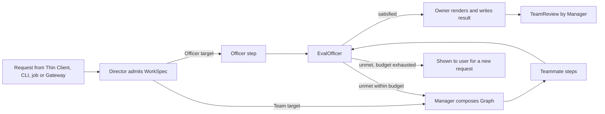

# KnowledgeOS Blueprint

KnowledgeOS turns the ideas and notes the user writes freely in the KnowledgeHub Vault into reusable, findable knowledge and uses that accumulated knowledge to strengthen the user's thinking. This document is the system contract: surfaces, the execution organization, the Vault data model, effect rules, AgentFabric Core conformance and engineering constraints. The user-facing intent is [USER_FEATURE_SPEC.md](USER_FEATURE_SPEC.md); per-capability behavior and acceptance examples are in [docs/CAPABILITIES.md](docs/CAPABILITIES.md).

## 0. Spec governance

The spec is a living contract, not a phase document. These rules keep it from rotting.

- **Current truth only.** The spec states intended behavior. It contains no history, evidence, install status, observed versions or "retained/legacy" sections. History lives in Git; progress and evidence live in `PROJECT_STATE.md`.
- **Precedence.** By explicit user decision, `docs/CAPABILITIES.md` is the top-level behavior and acceptance specification. `USER_FEATURE_SPEC.md` supplies intent and this Blueprint supplies system constraints; both supplement capabilities without weakening their acceptance coverage. This precedence does not authorize changes to Core contracts or schemas. A conflict is a defect to fix in the same change, never a tolerated divergence.
- **Spec and code move together.** A change that alters behavior edits the spec in the same change. When implementation teaches something the spec did not anticipate, revise the spec immediately rather than coding around it.
- **Delete, don't annotate.** Superseded text is removed, not marked deprecated.
- **Examples are the contract.** Preserve every acceptance ID and example in `docs/CAPABILITIES.md` as an executable test through a public interface. Fix implementation or testability gaps without deleting examples or narrowing their success criteria.
- **Thin vertical slices.** Build one capability end to end, use it, then refine the spec from what was learned. Unresolved choices stay in §9 until a slice needs them.
- **Stay small.** Prefer removing a rule to adding one. Add a type, property, role, capability or check only when real use needs it.
- **Owner-readable implementation guide.** Keep the mandatory beginner-readable technical wiki in the single Sites monorepo at `Sites/knowledgeos/wiki/`, with sole explanation originals in `Sites/knowledgeos/_source/`. The Operation owns content accuracy; Sites owns all HTML presentations and bounded public source copies. Follow `Sites/knowledgeos/_source/philosophy.md`: explain concrete inputs, processing, outputs and Hermes Profile, Graph and Temporal connections from current implementation evidence. Preserve acceptance and state references generated from authoritative Operation documents without creating another state ledger. Update in an independent Sites worktree, build/check only the KnowledgeOS namespace, review changed pages in a browser and merge through an ordinary GitHub PR. Select approved source/spec inputs with an explicit AgentFabric root; never serve the workspace root. Serve the static export through ExOps and private Tailscale Serve without activating deployment or requiring a universal console.
- **Spec and wiki move together.** Updating the wiki is also a periodic spec review: when writing or regenerating pages exposes a conflict between `docs/CAPABILITIES.md`, this Blueprint, `USER_FEATURE_SPEC.md` and `PROJECT_STATE.md`, fix the lower-precedence document in the same session instead of leaving a warning in the wiki, and remove §9 open questions that implementation has already answered.
- **Reference material.** `Tmp/active/knowledgeos-spec-references-2026-11-19/REFERENCES.md` maps earlier source that matches this direction. It is non-normative, and the spec wins on conflict.

## 1. Scope

In scope:

- Six user capabilities: organize, standardize, search, enhance, document management and daily-note handoff.
- Requesting them from inside Obsidian through a minimal Thin Client and community plugins.
- Management through a browser console and a CLI.
- An organization of Director, Teams (a Manager with teammates), Officers and an EvalOfficer, each with exclusive responsibilities.
- Scheduled jobs run by the Owner itself while it runs.
- Discord notices.
- Self-improvement of each Hermes role profile.
- AgentFabric Core conformance.

Follow-up (§9): mobile request and template flows through Apple Shortcuts, Working Copy and possibly GitHub Actions. All processing still happens in the Mac KnowledgeOS.

Out of scope:

- A mobile KnowledgeOS application.
- Document work in the browser or CLI.
- Discord commands or approvals.
- Remote or multi-user access.
- Automatic merging.
- Git operations run by KnowledgeOS.

## 2. Ownership and storage

| Area | Owner | Contents | Loss tolerance |
|---|---|---|---|
| `Vaults/KnowledgeHub/` | User (canonical) | Notes, attachments, templates, Bases, KnowledgeOS reports and proposals | Backed up through the user's GitHub private repository |
| `Operations/KnowledgeOS/` | KnowledgeOS | Source, spec, capability catalog, role definitions, scheduled-job declarations, Thin Client, console, tests | Git |
| `States/Operations/knowledgeos/` | KnowledgeOS | Request receipts, Work records, input snapshots, autofix change log, notice and Experience outboxes, the derived semantic vector index (`semantic/`) | Losable; never the only copy of user knowledge |
| `Runtimes/knowledgeos/` | Host | Python environment, Owner binding config, LaunchAgent logs, generated Hermes distributions | Rebuildable |
| Hermes KnowledgeOS profile homes under `States/System/Hermes/` | Host | Per-role model credential reference, skills, memory and sessions; the operations profile's Discord bot token | Host-owned; credentials are never copied |

Principle: **anything the user would miss lives in the Vault.** State holds only operational records. Losing State loses in-flight Work, undo shortcuts and pending notices, never accepted knowledge. Nothing from State, Runtime or Hermes homes is written into the Vault, so none of it is pushed to GitHub.

## 3. Surfaces

Each surface owns one kind of interaction. No surface duplicates another's job.

| Surface | Owns | Never |
|---|---|---|
| Obsidian core and community plugins | Writing, editing, templates, keyword search, navigation, views, tasks, the Git view | Calling KnowledgeOS |
| Thin Client | Invoking KnowledgeOS from the current note or selection through commands and one compact sidebar tab; reporting outcomes; starting and stopping the Owner service | Document lists, browsing Work, holding settings beyond the endpoint and the Owner's launchd label |
| Browser console | Observing and administering KnowledgeOS | Document work |
| CLI | Maintenance and installation, including batch standardization | Document authoring or review UI |
| Discord | Outbound notices | Accepting commands or decisions |

### 3.1 Obsidian

Plugins carry as many functions as possible, so open-source maintainers carry that maintenance and the Thin Client stays small. Plugins are configuration, not hard dependencies. The Vault stays usable as plain Markdown without any of them.

| Function | Plugin (core or community) |
|---|---|
| Note creation with standard frontmatter (authoring-time standardization) | QuickAdd choices with Templater templates |
| Keyword search, including Korean substrings | Core Search |
| Review queue, inbox, idea and project views, document management lists | Core Bases views over frontmatter and file metadata |
| Buttons for KnowledgeOS commands on proposals and typed notes | Note Toolbar, with Meta Bind buttons as an option |
| Property editing | Core Properties, Meta Bind inputs |
| Links, backlinks and hierarchy | Core Backlinks, Breadcrumbs |
| Tasks and dashboards | Tasks, Homepage |
| Folder and calendar navigation | Notebook Navigator, Daily Notes |
| Manual formatting | Linter, run on demand only. It never lints on save or on file change, and it never edits KnowledgeOS-managed keys |
| Git history and diff view | Obsidian Git, view only. Commit, pull and push stay with the user's sync routine |

`Home.md` and `Mobile.md` are native Reading View dashboards built from Markdown, Core Bases views and Tasks queries; the scoped `knowledgeos-home` snippet supplies density and container-responsive layout. No dashboard plugin or JavaScript application is involved.

**Thin Client contract:**

- **One command surface.** It registers the KnowledgeOS commands in capability C11 in the command palette and the file and editor menus. A ribbon icon or `사이드바 열기` reveals one reusable native sidebar tab with four navigation buttons (규격화, 정리, 강화, 찾기), an inline function region below them, context-only proposal decisions, a power button and inline more actions. Secondary choices, forms, current search results and preview decisions stay inside that region without popup menus or modals. It retains the last active note while its own tab has focus and adds no Work browser or persistent document lists. Note Toolbar and Meta Bind can still surface the same commands.
- **Owner lifecycle.** The Owner runs on the host as an on-demand user service that outlives Obsidian. `Owner 시작` kickstarts its launchd label and `Owner 중지` sends it SIGTERM, only when the user invokes them. Each reports what `GET /api/health` then shows: started once health is ready, stopped once it stops answering, otherwise still running or unknown. They send no note text.
- **Requests by reference.** A request sends the note path and the SHA-256 the client last saw, never the note body. The Owner answers at once with a request ID after committing the receipt. After a lost response, the client reads that receipt; only a definitive not-recorded response permits resubmitting the identical request. An unknown outcome never permits replay.
- **Minimal feedback.** The sidebar and status bar show connection state and in-flight count. Sidebar requests show outcome, errors and result links inline; input drafts are memory-only. Changing its function or note cancels an undecided standardization preview, including a late response, and never applies it implicitly. Palette and context-menu commands keep their small input and preview modals and settled-request notices; error notices stay until dismissed.
- **No authority, no writes on read.** Settings hold only the endpoint and the Owner's launchd label. Opening the sidebar, reading notes, navigation and reconnection never write plugin settings or start or stop the Owner.
- **Desktop only.** Mobile is in §3.5. `Owner 시작` and `Owner 중지` use the host's `launchctl` and exist only on desktop.

### 3.2 Browser console

An Operation-owned HTML/JavaScript page under `frontend/`, served by the KnowledgeOS ExOps backend on loopback.

- **Observe:**
  - Work list and detail: WorkSpec, Graph segments, role invocations with profile, model route and skill digest, evaluations, RemainingWork, TeamReview.
  - Scheduled job runs.
  - Unknown outcomes.
  - Attention items that Bases cannot express (capability C5).
  - Notice log, Experience outbox, role-profile map with learning ledgers, and health with observation time.
- **Administer**, through the same ExOps admission as every client:
  - Cancel a running Work.
  - Pause or resume a scheduled job.
  - Record reconciliation of an unknown outcome after explicit confirmation, preserving historical Work, receipts and evidence.
  - Mark a TeamReview proposal as considered.

### 3.3 CLI

A maintenance interface for the operator:

- Health.
- Search index rebuild and verification.
- Vault check (invalid YAML, conflict markers, duplicate IDs).
- Manual scheduled-job triggering through `job run`, following the admitted execution receipt.
- Batch standardization with `--dry-run` and `--apply`.
- Installation and sync of role profiles and the outbound-only `kos-ops` profile from source declarations.
- Installation of the Owner's on-demand macOS LaunchAgent (`install service`; `--dry-run` prints the plist and `launchctl` argv and writes nothing). It loads the service without starting it.
- Reconciliation.
- Work export.

Every mutating command uses the same Owner admission and effect rules as the other surfaces. A scheduled-job trigger receipt confirms only triggering; the separately admitted request's execution receipt owns the Work outcome, and CLI job runs follow it.

### 3.4 Discord

One KnowledgeOS-specific bot delivers actionable-only review digests and conflict or unresolved-effect alerts (capability C8), plus the morning daily-note task reminder (C12). Failed, blocked and missed jobs never send immediate alerts; a quiet digest sends nothing. It is outbound only: the `kos-ops` profile is installed parked (`gateway.parked`), so a Hermes gateway starts neither a Discord adapter nor cron for it, and delivery uses `hermes -p kos-ops send` alone. Links in a notice open Obsidian or the console. A message, reaction or reply never changes anything.

### 3.5 Mobile

The Vault syncs to iPhone and iPad through Git and GitHub with Working Copy, and the user edits there in Obsidian. KnowledgeOS has no mobile component. Changes arriving through a pull on the Mac are processed by scheduled jobs like any other edit. Mobile request and template flows are follow-up work (§9).

The canonical current iPhone Obsidian profile lives in MacBook-managed `Vaults/KnowledgeHub/.obsidian-phone/`. `config/obsidian-mobile/profile/` is its versioned reference preset, maintained explicitly rather than applied by an updater. The whole phone tree participates in the existing GitHub–Working Copy Pro flow subject only to unchanged common `.DS_Store` and temporary-file exclusions; workspace and cache files can therefore sync. No new updater, build target or sync pipeline is introduced. Mac appearance JSON, theme, plugin assets, the other profile, Mac ignore rules and existing Working Copy connections remain unchanged; within that profile, only the authorized Home/Mobile stylesheet content changed, while the Vault's `Home.md` and `Mobile.md` carry the dashboards below.

`Home.md` keeps seven workflow sections: triage tasks, waiting AI proposals and the Inbox; a full-width active-project ledger; open questions and current reading (읽는 중); and a dynamic untouched-idea view. `Mobile.md` opens directly with today's tasks, the Inbox, a read-only AI review that preserves the original Queue inclusion of proposals and reports, current projects and full-list navigation. Tasks queries filter, sort and limit natively (6 on Home, 5 on Mobile) while hiding counts, backlinks and tags. Original full Base views remain unchanged; bounded compact views are additive (Home 3, Mobile 5, ideas 2; the original Projects Now stays at 5) and link back to the full views. Mobile primary text is 16px and scoped action targets are at least 44×44 CSS pixels. All layout rules are scoped to these two notes and respond to the note container's width.

QuickAdd provides Today, native Inbox input and five typed-note commands (idea, question, knowledge, source, project). The typed commands reuse `99_System/Templates/`, ask only for a title, reject executable formatter delimiters before normalization, initialize empty aliases and preserve existing notes. Project creation uses the existing project-directory helper. Body input stays in the normal editor; QuickAdd Capture is not used. Templater on-create execution and mobile core Daily Notes remain disabled; explicit Today rendering preserves an existing daily note.

Note Toolbar reads the existing `type` property to select seven note-type toolbars without modifying notes. Phone and tablet use five labeled bottom slots: home, today, new-note chooser, contextual action and find. Contexts lead to the Inbox, task dashboard, related note creation or review queue. The review-folder mapping precedes a wildcard fallback, so nested and unclassified notes still have navigation. Desktop toolbars remain hidden. Tasks keeps `#task` and forwarded `>` as non-task; Homepage opens `Mobile.md`. The five community plugins remain QuickAdd, Note Toolbar, Templater, Tasks and Homepage.

The phone-only `mobile-toolbar` snippet remains enabled through `appearance.json` for the five-slot bottom toolbar and other phone actions, giving them a minimum 44×44 CSS pixels while retaining labels and native wrapping. The shared `knowledgeos-home` stylesheet lives at `99_System/CSS/dashboard.css` and is mirrored in the actual Mac snippet, the actual phone snippet and the reference preset; phone source and actual `appearance.json` enable both `[mobile-toolbar, knowledgeos-home]`. Every rule is scoped to Home/Mobile and uses native theme variables. Mac appearance JSON, theme and third-party plugin assets are unchanged; the only Mac stylesheet content change is the authorized Home/Mobile rules. The existing five toolbar slots and seven QuickAdd commands are unchanged. Profile preparation and Mac rendering are not physical-iPhone runtime or remote delivery.

This is explicit owner-selected configuration maintenance, not KnowledgeOS Owner runtime plugin management. Section 5.7 still prohibits runtime Git operations and device-local writes; Owner startup and M1–M3 stay unchanged. Applying changes on iPhone separately requires the existing Mac sync push and Working Copy Pro pull, then **Settings → Files and links → Override config folder** set to `.obsidian-phone` and app reload. Back up any prior phone profile; a dotfolder hidden in iOS Files does not require a new directory link.

The mobile request follow-up reserves these interfaces:

- The frontmatter property `kos_request`.
- The folder `00_Inbox/Requests/`.

Both are inactive until the follow-up specifies them, and KnowledgeOS must not use either name for anything else.

## 4. Execution organization

### 4.1 Responsibility map

Every object owns exactly one responsibility and nothing else. If a duty fits two objects, the spec is wrong and must be fixed.

| Object | Owns | Never |
|---|---|---|
| **Owner** | Authority and effects: policy decisions, State, input snapshots, evidence handles, validation of submissions against schemas, rendering and writing Vault files, compiling Core records, notices | Choosing content, composing Graphs, judging criteria |
| **Director** | Admission: turning a request into an admitted `WorkSpec` (target, catalog criteria, budget, input scope) and admitting revisions when budget or target must change | Composing Graphs, producing content, evaluating |
| **Manager** (one per Team) | Graph composition for its Team: which admitted teammates run, in what order, and where the evaluation sits; successor composition from `RemainingWork`; TeamReview after completion | Producing content, judging criteria, instructing the EvalOfficer, admitting Work, writing files |
| **Teammate** | One kind of intermediate artifact (a handoff) within a Team Graph | Final results, evaluation, choosing other teammates |
| **Officer** | One bounded result, alone, with no Team or Manager | Delegation, evaluation |
| **EvalOfficer** | Independent assessment of the admitted criteria at a segment checkpoint | Producing, fixing or rewording output; seeing Manager rationale or teammate self-assessment |
| **Scheduler** | Triggering declared jobs | Deciding what a job does |
| **Notifier** | Delivering composed notices | Composing notice content |

Each step has a fixed runtime, `static` (Owner code) or `model` (a Hermes role profile). A step whose output the Owner could compute or verify byte for byte is `static`. Models contribute only judgment.

### 4.2 Roster

| Object | Kind | Runtime | Owns |
|---|---|---|---|
| Director | Director | static for structured requests; model (`kos-director`) for free-text requests | Admission and revisions |
| CurationManager | Manager of the Curation Team (capability C1) | model (`kos-curation-manager`) | Curation Graphs and TeamReview |
| `scout` | Curation teammate | static | Collects target notes, candidate related notes and the existing tag vocabulary |
| `classifier` | Curation teammate | model (`kos-classifier`, `openai-codex/gpt-6.1-terra`, effort `high`) | Judgment fields per note: type, status, title, tags, conventional folder; may ask the advisory `system_one(handle)` tool |
| `linker` | Curation teammate | model (`kos-linker`) | Links and typed relations to existing notes; attaching a capture to an existing note |
| ThinkingManager | Manager of the Thinking Team (capability C4) | model (`kos-thinking-manager`) | Thinking Graphs and TeamReview |
| `retriever` | Thinking teammate | static | Collects evidence candidates around the focal note or question |
| `connector` | Thinking teammate | model (`kos-connector`) | What the user already wrote that relates, and connections and tensions between notes |
| `challenger` | Thinking teammate | model (`kos-challenger`) | Gaps, counterpoints and open questions |
| `synthesizer` | Thinking teammate | model (`kos-synthesizer`) | The final cited report, including next steps |
| StandardizationOfficer | Officer (capability C2) | static; asks System One for rule-9 closed-set values | Conformance of one or more notes: deterministic rules plus confident System One enum choices |
| StewardshipOfficer | Officer (capability C5) | static; asks System One for status predicates | Attention items, lifecycle suggestions and digest content |
| EmbeddingOfficer | Officer (capability C3) | static; calls the local Ollama embedding model over loopback | Incremental vector index of eligible notes |
| DailyOfficer | Officer (capability C12) | static | Today's daily note, unfinished-item handoff and the morning task reminder |
| EvalOfficer | EvalOfficer | static checks always; model (`kos-eval`) for semantic criteria | Assessments for every Work |
| Scheduler | Owner service | Static; slots from `config/jobs.json`, runs only while the Owner runs | Triggering declared jobs |
| Notifier | Host service | Delivery through the operations profile `kos-ops` | Delivery |
| System One | Owner service | OpenAI Decisions API (`gpt-6-luna`) called directly by the Owner; no Hermes profile | Typed closed-set answers (`choice`, `predicate`): C2 rule 9, the `system_one` role tool of the C1 and C4 model teammates, C3 neighbor vetting, C5 status proposals, the C11 free-text prefilter. Never writes, authors text or decides `ai_policy`/`sensitivity` |

Search (capability C3) is a service the Owner provides to people and to roles through tools. It is not a role; only keeping its vector index current is Officer work (EmbeddingOfficer).

Adding or removing a role, teammate or Team is a spec change, reviewed by the user, and usually prompted by a TeamReview proposal.

### 4.3 Work flow

- **WorkSpec.** Criteria come from the catalog per capability and mode. Models never author criteria. Every criterion names fields that exist in the submitted artifact and is assessable at the segment checkpoint.
- **Graph.** The Manager proposes only ordered teammate IDs from the admitted pool and the evaluation position after the last producer. The Owner validates the proposal and builds the Core `GraphSpec`, `GraphAssignment` and `GraphSegment`. Teammate assignments use `selection_authority=bounded_manager`. The evaluation node uses `owner_officer` with the WorkSpec's EvalOfficer pin. Any attempt to set its instructions, inputs, route, criteria or position, or to nominate it as a teammate, is an authority violation: no segment, no corrective turn, and the Work fails. An admitted segment never changes.
- **Evaluation.** The Owner records the evidence checkpoint before evaluating. Static checks run first. The EvalOfficer model judges only semantic criteria, from criteria, check results and bounded artifact excerpts. The Owner may only lower a judgment when a static check failed for the same target, and it compiles `CompletionAssessment` and `RemainingWork`.
- **Continuation.** An unmet assessment returns to the same Manager for a successor segment addressing only `RemainingWork` within budget. Defaults: 2 segments and 6 producer invocations for Teams; 1 segment for Officers. Every static or model teammate step consumes producer budget; a corrective turn does not. The same unmet criteria and targets at two successive checkpoints ends the Work unmet. A changed target or objective needs a new Director admission.
- **TeamReview.** After completion the Manager rates each producing teammate and records up to three teammate proposals, with considered status visible in the console. Proposals remain advisory TeamReview and role feedback, plus local `ExperienceSourceEvent` observations (`routine_progress`, `not_evaluated` for the proposal); they create no Candidate or outbox item. Advisory text may suggest role changes but never enacts them. Submission fields claiming authority to change roles, the catalog or an assessment are rejected without a corrective turn. The user changes the spec and catalog.
- **Model submissions.** Ordinary validation failures receive one corrective turn with diagnostics. A second failure ends that step as failed and leaves its addressed criteria unmet; missing valid output is not sent to the EvalOfficer for certification. Authority violations by Manager Graph or TeamReview submissions or by the model Director are rejected immediately without a corrective turn.

### 4.4 Hermes role profiles

- Each model role has its own Hermes profile (§4.2). Its model route is fixed in profile configuration. An unavailable model or credential fails the step visibly; there is no silent reroute.
- `config/roles.json` fixes the routes and profile options: `classifier`, `linker` and `connector` use `openai-codex/gpt-6.1-terra`; Director, Managers, EvalOfficer, `challenger` and `synthesizer` use `openai-codex/gpt-6.1-sol`. Every model role uses `reasoning_effort: high`, mapped under `agent` in generated profiles. The classifier has no local `base_url`, `ollama_num_ctx` or model fallback. These route settings do not change note policy.
- **Tools come from the Work binding, per role:**
  - Director: policy-filtered references to user-named notes and catalog view, plus a draft selecting an allowed standardization preview, organize or enhance command. The Owner supplies paths, digests and binding fields and performs static admission. The model cannot author criteria, budgets, target authority, WorkSpec, input bindings or routes; such attempts admit no Work and receive no corrective turn.
  - Managers: team view (admitted pool, budget, prior segments, RemainingWork), Graph submission and TeamReview submission. No note reading.
  - Teammates: work context, read, search and related tools within the Work scope, plus handoff submission. Every model teammate (`classifier`, `linker`, `connector`, `challenger`, `synthesizer`) also has `system_one(handle, question, choices?)` for one closed question about a note read in the Work, at most 10 requests per step; answers are advisory and never written. The `classifier`'s call without `question` on a target is the type/status suggestion, recorded per target on the Work and reused. The `synthesizer` submits the report.
  - EvalOfficer: evaluation view and evaluation submission only.
  - Every role: a `feedback` view of outcomes of its own earlier outputs.
- **Disabled everywhere:** terminal, file, browser, web, code execution, delegation, messaging and cron-management tools.
- **Evidence handles.** Read tools return short per-Work handles such as `e7`, each naming a bounded body chunk of at most 40 lines with its exact bytes and locator. Selected inputs disclose the admitted snapshot; other notes disclose their current bytes at read time. Every disclosure rechecks the current file and policy and fails closed. Roles cite handles, and the Owner expands them into exact citations. Models never type paths, IDs or digests that the Owner can compute.
- **Invocation.** The Owner invokes a role session bound to one Work and step. The binding, not model input, decides the Work, readable notes and permitted submissions.
- **The `kos-ops` profile** runs no model and no scheduler. It only sends Discord notices for the Owner and holds the KnowledgeOS Discord bot token.

### 4.5 Self-improvement

- Each role profile updates its own skills and memory autonomously through Hermes native learning. Background review and the skill curator are enabled, and changes are recorded in each profile's skill ledger.
- Profiles never share skills or memory. Learning stays inside one responsibility.
- Learning never widens permissions; tools come only from the Work binding.
- Role-specific feedback drives learning:
  - The `classifier` and `linker` see which of their proposed changes the user applied, unchecked or rejected.
  - The `synthesizer` sees report edits, promotion or deletion.
  - Managers see assessments and their own TeamReview history.
  - The EvalOfficer sees cases where the user rejected a result it rated satisfied.
- Each Work records, per invoked role, the profile name, model route and a skill-set digest taken once at session start.
- Fabric-level learning sends only evidenced, Core-eligible lifecycle events to HermesTrace as Experience (capability C9). Every TeamReview proposal stays a local `routine_progress` SourceEvent with `evaluation_state=not_evaluated` for the proposal, alongside TeamReview, role feedback and console visibility; it creates neither an `ExperienceCandidate` nor an outbox item. Local observations are bounded and expire under C9 retention, not retained as a permanent promotion queue. A later actual correction, failure, policy denial or other eligible event has its own evidence and SourceEvent/Candidate; it is not automatic promotion of the earlier proposal, and no such promotion is promised. KnowledgeOS adopts a promoted capability only through an explicit, version- and digest-pinned configuration change.

## 5. Vault contract

### 5.1 Free editing

- Ordinary Markdown is a valid source with or without frontmatter, in any folder. KnowledgeOS never requires registration, fixed paths or manual index refresh.
- The user may create, edit, move, rename or delete any note at any time, on any device, including during a Work.
- Obsidian and its plugins remain fully usable without KnowledgeOS.
- KnowledgeOS never byte-pins user files. Obsidian may reformat `.base` and settings files freely.

### 5.2 Note types

`type` is the only classification KnowledgeOS relies on. Folders are conventions used to derive a missing type (capability C2), not requirements.

| Type | Meaning | Conventional folder | Status values |
|---|---|---|---|
| `capture` | Raw, quickly written input to be processed | `00_Inbox/` | `unprocessed`, `processed` |
| `idea` | An idea or hypothesis the user is developing | `40_Knowledge/Ideas/` | `seed`, `developing`, `mature`, `dropped` |
| `knowledge` | A claim or understanding the user holds | `40_Knowledge/Notes/` | `seed`, `developing`, `evergreen` |
| `question` | An open question worth returning to | `40_Knowledge/Questions/` | `open`, `answered`, `dropped` |
| `project` | A project hub note | `20_Projects/<name>/<name>.md` | `planned`, `active`, `paused`, `done` |
| `source` | Material the user read or referenced | `40_Knowledge/Sources/` | `unread`, `reading`, `read` |
| `daily` | One day's schedule, tasks and short memos; never a proposal target | `10_Journal/Daily/YYYY-MM-DD.md` | None |

- Every type with status values also accepts `archived`; `90_Archive/` is its conventional folder. Daily notes have no `status` and are never targets of AI proposals.
- Navigation notes identified as `home` or `system` are not processed; the Vault root alone never makes ordinary Markdown a navigation note.
- KnowledgeOS output types (`report`, `proposal`) are defined in §5.6.
- A note of an unknown type stays readable and searchable, and curation may propose a known type.
- Templates for each type live in `99_System/Templates/` and produce conforming frontmatter.

### 5.3 Properties

Frontmatter is flat YAML. KnowledgeOS never deletes, renames or reorders properties it does not manage, so extra user properties are always safe.

| Property | Applies to | Rule |
|---|---|---|
| `id` | all | UUIDv4. Required for standardized notes. Identifies a note across moves and renames |
| `type` | all | One of §5.2 |
| `created` | all | ISO-8601 with offset. Time zone `Asia/Seoul` unless the note states another |
| `ai_policy` | all | See §5.4. Missing or empty means `approve` |
| `sensitivity` | all | `public`, `personal` or `confidential`. Default `personal` |
| `status` | typed notes except `daily` | Value from §5.2 |
| `title` | optional | Display title. The file name is used when absent |
| `tags` | optional | YAML list of strings without `#` |
| `aliases` | optional | YAML list of strings |
| `related`, `projects`, `sources` | optional | Lists of wikilinks: general association, owning projects, supporting sources |
| `supports`, `contradicts`, `derived_from` | optional | Lists of wikilinks with directional meaning from this note to the target |
| `captured_from`, `capture_kind` | `capture` | Origin (device, app or `operation/<id>`) and kind (text, link, voice, image) |
| `claim`, `confidence` | `knowledge` | One-sentence claim; `low`, `medium` or `high` |
| `outcome`, `next_action`, `priority`, `target_date` | `project` | Project hub fields |
| `source_kind`, `source_url`, `authors`, `published_date` | `source` | Bibliographic fields |
| `kos_request` | reserved | Mobile request marker (§3.5). Inactive |

Body wikilinks are ordinary associations. Typed relation properties exist only where the user wrote them or applied a proposal adding them. KnowledgeOS never infers them silently.

### 5.4 Privacy

`ai_policy` controls what KnowledgeOS automation and models may do with a note. It does not control Git synchronization.

| Value | Deterministic processing | Every model, including Ollama and System One | Scheduled jobs | Gateway export |
|---|---|---|---|---|
| `approve` | yes | yes | yes | non-report notes, to authorized recipients |
| `deny` | no | no | no | no |

- Missing or empty `ai_policy` means `approve`. Every other value, including retired `remote_ok`, `ask` and `local_only`, fails closed to `deny`. With unparseable YAML, the raw `ai_policy:` line uses the same mapping; absent means `approve`, while capability-specific invalid-YAML exclusions still apply.
- `sensitivity`, including `confidential`, does not change `ai_policy`.
- Policy decisions belong to the user. KnowledgeOS never writes an existing note's policy, except C2 rule 6 adds missing `ai_policy: approve`; newly generated notes carry their specified default or inherited policy. There is no configurable Owner default.
- `deny` notes are never indexed, read, standardized, sent, exported or mentioned in notices.
- Output inherits the strictest policy among the focal or target note and every note read in the Work, including notes not ultimately cited: in practice `approve`; a source becoming `deny` mid-Work fails closed.
- Policy is checked against current content immediately before disclosure. A moved, deleted or newly restricted source fails closed. Request origin and model location never widen eligibility.
- Discord digests and immediate alerts may disclose only `approve` note titles and links, never body text. The C12 daily reminder may additionally disclose open-item text from currently `approve` notes; other notes are never read or mentioned.
- System One follows the same `approve`-only rule. Its credential is a host-owned 0600 file outside Git and the Vault, and no secret reaches Hermes subprocesses.
- Core classification maps `approve` to `internal` and `deny` or unknown values to `restricted`.

### 5.5 Identity and references

- A note is identified by its `id`, or by its Vault path until it has one.
- Duplicate IDs never remove either note from search. Targeting by an ambiguous ID is refused, and the duplicate becomes an attention item.
- A reference to a note at a moment is a Core `ResourceReference`:
  - `owner_operation_id=knowledgeos`, `resource_kind=vault`.
  - The note ID or path as `logical_id`.
  - The SHA-256 of the exact bytes read as `content_digest`.
- A citation is `{resource_reference, chunk_locator, chunk_hash}`. It proves which bytes were read, not that the claim is true.

### 5.6 Files KnowledgeOS writes

| File | Location | Lifecycle |
|---|---|---|
| Report | `01_AI_Review/Reports/` | Created once. Afterward it is the user's document to edit, move, promote or delete. It is not used as evidence until the user changes its `type` |
| Proposal | `01_AI_Review/Proposals/` | Created once, with only the bounded regeneration exception below. KnowledgeOS deletes it after apply, reject or stale expiry; Git keeps its history |
| Gateway capture | `00_Inbox/` | Created once per admitted submission with `captured_from: operation/<id>` and flat message, sender and received-at provenance. A duplicate returns the original receipt. It then follows ordinary capture standardization, curation and user editing rules (C10) |
| Daily note | `10_Journal/Daily/YYYY-MM-DD.md` (default C12 folder) | Created once per day by C12 when absent, at the exact path without a suffix. Afterwards it is the user's note; only C12's bounded insertion and carried-item marking, C2 standardization and explicit user actions may modify it. Never a proposal target |

- **Every report and proposal carries:**
  - `id`, `type` and `created`.
  - `ai_policy`, the strictest of its inputs.
  - The originating Work ID.
  - Wikilinks to its inputs.
- **A proposal also records:**
  - Its target and the target's exact SHA-256 preimage.
  - A checklist of changes the user can edit.
  - A machine-readable change block, so it can still be applied after State is lost.
- **Regeneration exception.** At most one open or stale proposal reserves a target. The Owner may regenerate it in place only if its bytes still exactly match the Owner-written version recorded in State, checked again immediately before replacement. User-edited or State-unrecorded proposals are preserved without creating a duplicate. An unchanged stale proposal may be refreshed by an explicit new user request under the same checks; otherwise it reserves the target until decision or seven-day stale expiry.
- **Neither file contains** State paths, credentials or snapshot bytes.

### 5.7 Git

The Vault is a Git repository synchronized with the user's GitHub private repository. The Mac uses the user's sync routine and iOS uses Working Copy. That repository is the Vault's backup and history.

- **No Git operations by KnowledgeOS.** It never runs commit, pull, push, checkout or reset. The user's sync routines are the only Git writers.
- **Minimal diffs.** Writes are frontmatter-centered and preserve encoding, line endings, key order, quoting and untouched lines. This keeps diffs readable and merge conflicts rare across devices.
- **Pulled changes are ordinary edits.** KnowledgeOS detects change from file content, not from Git.
- **Conflict markers.** Notes containing merge-conflict markers are skipped by all automation and listed as attention items.
- **No device-local writes.** KnowledgeOS never writes Git-ignored or device-local paths such as `.obsidian*/`, plugin data and workspace layout.
- **Git can always revert.** Any KnowledgeOS change can be reverted through Git history, independently of the State change log.

## 6. Effect rules

Effects are Vault writes, role invocations, notices and Gateway exports.

1. **One writer.** Only the Owner writes to the Vault for KnowledgeOS. No role has file, shell or network tools.
2. **Create-only outputs.** Reports and proposals start as new files; a name collision gets a suffix. The sole regeneration exception is an existing proposal that still exactly matches its recorded Owner-written bytes (§5.6). Reports never regenerate, and proposal regeneration never overwrites user edits.
3. **Narrow modification.** Existing source notes change only through standardization (capability C2), a proposal the user applied, an undo the user requested, or C12's insertion of carried items into today's daily note and `[>]` marking of those items in earlier daily notes. Daily notes are never proposal targets. Proposal lifecycle actions follow C6 and §5.6. KnowledgeOS never deletes user notes and moves or renames them only by applying a proposal.
4. **Exact preimage.** Every modification compares the file's current SHA-256 with the expected preimage immediately before an atomic replacement. On mismatch it does not write. There is no merge, stale-preimage overwrite or retry loop.
5. **Intent before effect.** The Owner records an effect's intent before performing it.
   - **Vault writes** are resolved by reading the file: the expected result means applied, the preimage means not applied, and anything else is a conflict shown to the user.
   - **Role-invocation and notice outcomes** that cannot be observed stay `unknown` and are never re-sent or re-run automatically.
6. **Idempotent requests.** Each request carries a stable request ID. The same ID with the same content returns the recorded result; the same ID with different content is a conflict. Idempotency keys include the capability version.
7. **Snapshots.** Admission captures the exact bytes of selected inputs into State. The Work reads and cites those bytes even if the user edits the original meanwhile; other reads bind their exact version when disclosed (§4.4). A result states when any version read differs from current content. Applying it still requires the current preimage.
8. **Freshness is per document.** A changed note invalidates only results about that note, never the whole Vault.

## 7. AgentFabric Core conformance

KnowledgeOS selects exact Core, schema and semantic pins in one adoption file and satisfies the nine Capsule functions with this mapping. Core contracts and schemas remain unchanged; exported engine, binding and evidence pins must describe the actual Temporal/LangGraph execution, not merely schema-valid labels.

| Capsule function | KnowledgeOS realization |
|---|---|
| identity_manifest | `OperationManifest` for `knowledgeos` with exact pins and instance ID |
| domain | The Vault contract (§5) and capabilities |
| control_evaluation | Director-admitted `WorkSpec` with `target_kind=officer` (StandardizationOfficer, StewardshipOfficer, EmbeddingOfficer, DailyOfficer) or `target_kind=team` (Curation, Thinking). Manager-composed `GraphSpec` and `GraphSegment`. EvalOfficer `RunEvaluation`, then `CompletionAssessment` and `RemainingWork` compiled by the Owner |
| gateway | InterOps intake and bounded query (capability C10) |
| policy_authority | Actors are the local user (Thin Client, console, CLI), `schedule/<job>` and authorized Operations. `PolicyDecision` is made at admission and at effect |
| state_evidence | `ResourceReference` for notes, `ArtifactReference` for reports, proposals and TeamReview, `EvidenceObservation` for checks |
| runtime_lifecycle | `HealthReport` with observation time and stale or unavailable dependencies |
| experience_extraction | Eligible evidenced lifecycle events become `ExperienceSourceEvent` and then `ExperienceCandidate` for HermesTrace; ordinary TeamReview proposals stay bounded local SourceEvents only (capability C9) |
| human_observability | Console `StatusSnapshot` and `GraphRunSnapshot`, Thin Client outcomes, Discord `AlertEvent`. `HumanActionRequest` and `HumanActionResponse` record apply, reject, undo and console actions, distinguishing received, applied and unknown |

- **ExOps.** The Thin Client, console and CLI share one admission path. The backend binds loopback only, automatically checks Host and Origin, accepts JSON-only mutations, grants no cross-origin access and needs no login, account or token. GETs are observational: they never trigger Work, persist decisions, send notices or reconcile outcomes.
- **Discord.** KnowledgeOS has its own bot identity. The host-owned `kos-ops` profile holds the token. KnowledgeOS owns actionable-only notice content, routing and outcomes (C8 review digests and conflict/unknown-effect alerts; C12 daily reminders). A message, reaction or link visit never approves anything.
- **Retention.** Follow the Core retention policy for detailed history, unprocessed requests and deduplication windows. Keep unresolved outcomes until resolved.

## 8. Engineering constraints

1. Validate at admission and at effect commit. Inside a Work, a tool call checks only the Work binding and the policy of the resource it touches.
2. Compute implementation identity once per process and record it per Work. Never rehash code or contracts per call.
3. One capability catalog declares capabilities, modes, targets, criteria, budgets, teammate pools, step runtimes and tool grants. Role definitions (SOUL and instructions per role) live beside it. No second registry.
4. One execution engine runs every Officer and Team Work, using Temporal for the durable Work lifecycle and LangGraph to execute admitted Graph segments. Role logic is a handler or a profile, never a separate pipeline.
5. State writes are per record or append-only. Nothing rewrites the whole State on a timer or per request.
6. Cache immutable inputs, such as the catalog, roles and policy, by file identity, and reparse only on change.
7. Each payload has one canonical serialization. Never embed duplicate copies.
8. Reads never write. Client settings are per-device conveniences, never authority.
9. Tests exercise public interfaces (ExOps API, role tools, job entrypoints, CLI) on disposable Vault fixtures, with scripted role responses for model steps. They assert behavior, not internal structure. The suite runs in minutes and is safe to parallelize.
10. Prove composition with real dependencies (Hermes profiles, the Owner scheduler, model routes, plugin loading in Obsidian) through small smokes in the real environment. Record source, runtime and device evidence separately in `PROJECT_STATE.md`.

## 9. Open questions and follow-ups

Open questions:

- **Semantic ranking.** Whether the default `related_min_score` and neighbor count in capability C3 match real notes.
- **Schedules.** Whether the default job intervals in capability C7 match actual use.
- **Plugin choices.** Whether core Bases suffices for document management views or a further community plugin is worth adopting.

Follow-up M (mobile; specified when started, see `docs/CAPABILITIES.md` follow-ups):

- **M1 Templates and sync shortcuts.** Apple Shortcuts that create notes from the Vault templates with conforming frontmatter and drive Working Copy pull, commit and push.
- **M2 Vault-borne requests.** Mobile marks a note with `kos_request`, or adds a request note in `00_Inbox/Requests/`. The Mac KnowledgeOS admits it after the next pull and writes results that sync back.
- **M3 GitHub Actions.** Possible deterministic checks on push (YAML validity, conflict markers, duplicate IDs) reported back to the user. Any Action that commits makes it another Git writer and requires a revision of §5.7. Actions never call models and receive no KnowledgeOS credentials.
