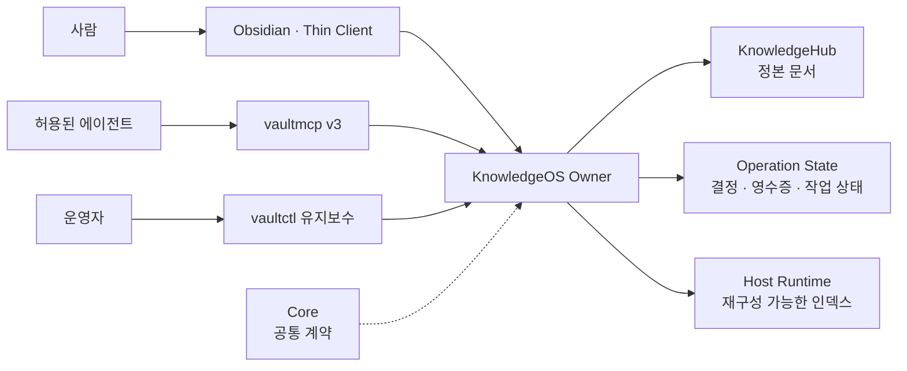
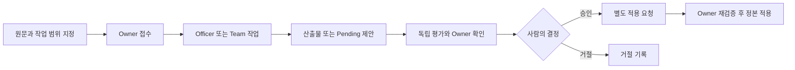

# KnowledgeOS

KnowledgeOS는 AgentFabric에서 개인 지식 저장소 [KnowledgeHub](../../Vaults/KnowledgeHub/)를 관리하기 위해 개발 중인 Operation입니다. 사람은 Obsidian에서 Markdown 노트를 작성하고 검토하며, 에이전트는 허용된 자료를 근거로 검색·분석하거나 변경안을 제안합니다. **자료 접근과 변경의 최종 권한은 KnowledgeOS Owner에 있고, 일반적인 제안의 승인과 정본 적용은 별개의 단계입니다.**

> **현재 위치:** 검색·검토·작업 제어의 소스와 격리 검증이 있고, 실제 모델을 사용한 단일 Officer 작업도 합성 자료로 끝까지 확인했습니다. 다만 일곱 Team의 실제 실행, 상시 운영 서비스와 Obsidian을 통한 전체 작업 흐름이 완성된 것은 아닙니다. 아래의 검증 범위를 확인하세요.

## 무엇을 할 수 있나

| 목적 | 사용자가 경험하는 기능 | 현재 범위 |
| --- | --- | --- |
| 기록과 탐색 | Obsidian에서 노트 작성, 링크·속성·할 일 탐색, QuickAdd와 템플릿 사용 | KnowledgeHub의 Markdown과 YAML이 정본입니다. |
| 근거 검색 | 어휘 검색과 원문 구간·출처 확인; 선택적으로 Vector·Hybrid·온톨로지 검색 | 검색 방식의 소스는 구현되어 있습니다. 읽기 전용 Owner는 Lexical만 제공합니다. Vector/Hybrid에는 별도의 로컬 모델과 유효한 인덱스가 필요합니다. |
| 근거 있는 답변 | 에이전트가 허용된 문서를 읽고 인용과 함께 답변 | 실제 Hermes와 모델로 **합성 문서** 검색부터 출처 확인 및 답변까지 검증했습니다. 인용 검증은 출처·구간·해시를 확인할 뿐 주장의 진실을 보증하지 않습니다. |
| 노트 개선 제안 | 문서의 메타데이터·관계 또는 정규화 결과를 제안하고 근거와 변경 내용을 검토 | Owner와 Thin Client 소스 및 격리된 경로가 있습니다. 실제 Obsidian에서 Owner에 연결한 검토·승인·적용은 미검증입니다. |
| 작업 실행 | 한 Officer가 제한된 범위에서 작업하거나 Team이 여러 역할을 조합 | 단일 NormalizationOfficer는 실제 Temporal과 모델을 사용해 격리 검증했습니다. 일곱 Team의 native 실행은 아직 검증되지 않았습니다. |
| 유지보수 | 상태·인덱스·계약·영수증·복구 점검 | `vaultctl`은 운영 도구입니다. 일반 노트 작성, AI 답변 및 모델 실행용 CLI가 아닙니다. |

## 구성과 권한 경계

- **Obsidian**은 사람이 노트를 작성하고 제안을 검토하는 화면입니다. Thin Client의 화면이나 버튼 자체가 Owner 권한을 만들지는 않습니다.
- **`vaultmcp`**는 에이전트의 단일 지식 작업 진입점입니다. 도구가 목록에 보이는 것과 호출이 허용되는 것은 다릅니다. Owner는 작업, 역할, 자료 범위와 효과 권한을 확인합니다.
- **Owner**는 자료 접근, Work 접수, 결과와 효과를 관리합니다. Core, 이 Operation의 소스, 독립된 Vault, Operation State, Host Runtime은 서로 다른 다섯 루트이며 실제 경로는 신뢰된 설정으로 지정합니다.
- **State**는 결정·영수증 등 보존할 운영 기록을, **Runtime**은 재구성 가능한 인덱스와 실행 자료를 둡니다. 둘 다 Git 및 동기화 루트 밖에 둡니다.

기본 `ai_policy: ask` 문서는 구성된 로컬 MCP 정책에서 허용됩니다. `deny`와 confidential 자료는 제외하고 `local_only` 본문은 신뢰된 로컬 실행 문맥에서만 반환합니다. 외부 모델에 이 제한을 우회해 원문을 보내지 않습니다.

## 제안은 어떻게 정본이 되나

다음은 일반적인 Pending 제안의 흐름입니다. **승인은 적용과 다릅니다.**

원문이 바뀌거나 정책·대상·근거가 일치하지 않으면 이전 제안을 그대로 적용하지 않습니다. Thin Client 소스는 오래된 원문을 표시하고, 메타데이터 제안에는 새 값별 근거와 정본 변경 diff를 보여주도록 되어 있습니다. 두 관련 Team의 결과와 독립 평가가 모두 기록되면 Owner가 조건을 다시 확인해 결합된 Pending 제안을 준비합니다. 실제 실행되는 Team과 Obsidian 화면에서 이 전체 흐름을 확인한 것은 아닙니다.

예외적으로 **Corpus Stewardship**의 일일 정리 방식은 독립 평가를 통과한 후보에 대해 Owner가 빈 속성에 근거 있는 값을 임시 선기록하고 `ai/pending`을 붙이도록 설계·구현되어 있습니다. 사람은 해당 추가분을 검토하거나 거절하며, 확인 전 AI 관계는 온톨로지 검색에 포함되지 않습니다. 이 경로의 실제 스케줄러와 Team 운영은 아직 연결되지 않았습니다.

## 구현과 검증은 어디까지인가

아래는 [현재 상태 기록](PROJECT_STATE.md)에 남은 관측을 사람이 읽기 쉽게 요약한 것입니다. 합성 자료의 성공은 실제 사용자 자료나 상시 서비스의 운영 성공과 다릅니다.

| 영역 | 확인된 것 | 아직 확인하지 않은 것 |
| --- | --- | --- |
| 읽기 전용 검색 | 설치 이미지의 MCP 검색·인용과 인증된 Owner HTTP를 격리 자료로 확인했습니다. 선택된 실제 Vault에 대한 Lexical 인덱스도 별도 유지보수 후 원문 세대를 검증했습니다. | 현재 시점의 서비스 기동·인덱스 유효성이나 실제 Obsidian 검색 결과를 보장하지 않습니다. |
| Hermes 검색·답변 | 실제 `openai-codex/gpt-6.1-terra`가 합성 문서를 검색하고 원문을 읽어 인용을 확인한 뒤 답변했습니다. | 실제 사용자 문서에 대한 모델 답변 품질이나 Vector/Hybrid 품질은 별도 검증이 필요합니다. |
| 단일 Officer | 합성 Capture 하나를 접수해 실제 Temporal Workflow·Activity를 거쳐 Pending 제안, 독립적인 결정론적 평가와 인증된 Owner HTTP 결과 조회까지 확인했습니다. 모델 없는 경로와 native Hermes 모델 경로를 각각 검증했습니다. | 실제 Vault에 대한 자동 적용, 모델 기반 평가, 상시 서비스 및 재시작·백업 복구를 증명하지 않습니다. |
| Team과 일일 정리 | 일곱 Team의 역할·방법 정의와 일일 정리, 제안, 검색의 격리 fixture 동작이 있습니다. | Manager가 구성하는 Temporal 기반 LangGraph Team, 실제 Cron과 운영 바인딩은 미검증입니다. |
| Obsidian | 선택된 macOS 프로필에서 사이드바와 문서 대상 전환, 검색 선택 화면을 관찰했습니다. | 인증된 Owner 검색, Work 결과, 제안 검토·승인·적용 및 기기별 왕복은 검증되지 않았습니다. 최신 실행 중 플러그인 상태도 사용 시 확인해야 합니다. |

다음 개발 단계는 **격리된 환경에서 전담 Manager와 필요한 구성원을 갖춘 native Team 하나를 Temporal 기반 LangGraph로 연결하는 것**입니다. 실제 서비스 채택과 Obsidian 사용 검증은 그와 별개입니다. Computer Use와 Obsidian 조작은 사용자가 직접 확인합니다.

### 일곱 Team은 무엇을 맡나

각 Team에는 전담 Manager가 정의되어 있으며, 필요한 구성원은 작업마다 선택합니다. 아래는 **역할 정의**이지 일곱 Team이 이미 실행 중이라는 뜻이 아닙니다. 단일 Profile로 처리할 수 있는 제한된 작업은 Manager 없는 Officer 경로를 사용합니다.

| Team | 담당하는 일 |
| --- | --- |
| Knowledge Curation | 포착한 자료를 분류하고 정규화·초안 제안 |
| Corpus Stewardship | 검토 대상 문서의 빈 속성과 관계에 근거 있는 후보 제안 |
| Evidence Research | 허용된 자료를 검색·종합하고 출처가 있는 답변 작성 |
| Relation Ontology | 관계 후보와 Blueprint 의미를 비교하고 제안 |
| Project Review | 선택된 프로젝트의 근거를 읽고 진행·회고 제안 |
| Knowledge Exchange | 허용된 Gateway 교환의 출처를 확인하고 지식 적용 제안 |
| Vault Maintenance | 스키마·링크·인덱스 등을 진단하고 복구 계획 제안 |

정확한 역할과 권한은 [Team 카탈로그](ops/config/team-catalog.json), [작업 방법](ops/config/work-methods.json), [MCP 도구 계약](ops/schemas/mcp/capabilities.json)을 확인하세요.

## 사용과 재현

### 사람이 KnowledgeHub를 사용할 때

[KnowledgeHub](../../Vaults/KnowledgeHub/)를 Obsidian에서 열어 Markdown을 작성하고 검색·링크·속성·할 일을 관리합니다. Thin Client는 선택된 프로필의 사이드바에서 문서 대상 Work, 검색 및 제안 검토를 위한 화면을 제공합니다. 실제 Owner 연결 및 각 기능의 사용 가능 여부는 별도 바인딩과 위의 검증 상태에 따릅니다.

Lexical은 기본 검색입니다. Vector와 Hybrid는 검증된 로컬 임베딩 모델과 원문 세대에 맞는 인덱스가 필요하며, Hybrid는 결과 순위를 RRF로 합칩니다. 온톨로지 검색은 승인된 관계를 사용합니다. 실제 한국어 질의에 대한 검색 품질을 측정하기 전에는 Vector/Hybrid가 더 낫다고 가정하지 않습니다.

### 읽기 전용 연결을 준비할 때

[읽기 전용 Owner 안내](docs/RUNTIME.md#read-only-owner-entrypoint)에 따라 다섯 루트, 신뢰된 actor와 비공개 토큰 파일을 명시합니다. 이미 초기화된 호환 Owner journal과 현재 원문에 맞는 Lexical 인덱스가 없으면 시작을 거부하며 자동 초기화·복구하지 않습니다.

- `make image-build`: 고정된 기반 이미지와 잠긴 의존성으로 이미지를 만들고 설치본 스모크를 실행합니다. 이미지 빌드는 네트워크가 필요합니다.
- `make owner-read-only-up` / `make owner-read-only-down`: 별도 선택된 루트로 읽기 전용 Owner를 시작·종료합니다. Lexical 검색과 기존 Work 조회만 허용하고 접수·승인·적용 등 변경 요청은 거부합니다. relay는 호스트 loopback에만 노출됩니다.
- [native Hermes 조회 연결](../../Runtimes/README.md#네이티브-hermes와-knowledgeos-조회): `kos-cited-answer`에 다섯 조회 도구를 노출하는 별도 설정입니다. 다른 역할 프로필이 있다는 사실은 Work executor가 등록되었다는 뜻이 아닙니다.

### 격리 실행을 재현할 때

[Officer 실행 안내](docs/RUNTIME.md#disposable-native-officer-execution)의 사전 준비 후 `make officer-image-build`와 `make officer-smoke`를 사용합니다. 실제 Vault 대신 합성 자료와 임시 State·Runtime을 사용하고, Temporal·PostgreSQL도 격리해 실행 후 정리합니다.

[모델 Officer 바인딩 안내](docs/RUNTIME.md#exact-native-model-officer-binding)의 `make model-officer-smoke`는 기존에 선택된 인증으로 **실제 외부 모델 호출**을 수행합니다. 모델에는 합성 자료만 사용하며 `work_context_read`, `knowledge_read`, `proposal_create` 세 도구만 허용합니다. 모델의 완료 문구가 아니라 Owner의 실제 효과 영수증과 독립 평가를 확인합니다. 인증·모델·경로가 맞지 않으면 다른 provider나 결정론적 실행으로 자동 대체하지 않습니다.

## 더 살펴보기

- [사용자 기능 명세](USER_FEATURE_SPEC.md) — 사람과 에이전트가 하는 일, 승인과 유지보수의 경계
- [Blueprint](OBSIDIAN_VAULT_BLUEPRINT.md) · [Whitepaper](OBSIDIAN_VAULT_WHITEPAPER.md) — 지식 구조와 설계 의도
- [Runtime 안내](docs/RUNTIME.md) — 바인딩, 이미지, 격리 스모크와 운영 조건
- [PROJECT_STATE.md](PROJECT_STATE.md) — 관측된 증거, 미검증 범위와 다음 작업의 기준

개발 검증은 프로젝트 컨테이너에서 `make source-check`, `make blueprint-check`, `make schema-check`, `make test`, `make lint`, `make state-check`로 수행합니다. 명령이 존재한다는 사실과 현재 환경에서 검증을 수행했다는 사실은 다릅니다.
