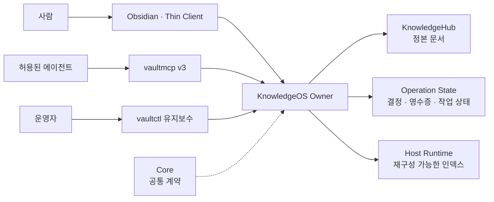
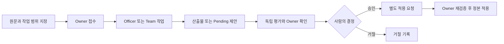

# KnowledgeOS

KnowledgeOS는 AgentFabric에서 개인 지식 저장소 [KnowledgeHub](../../Vaults/KnowledgeHub/)를 관리하기 위해 개발 중인 Operation입니다. 사람은 Obsidian에서 Markdown 노트를 작성하고 검토하며, 에이전트는 허용된 자료를 근거로 검색·분석하거나 변경안을 제안합니다. **자료 접근과 변경의 최종 권한은 KnowledgeOS Owner에 있고, 일반적인 제안의 승인과 정본 적용은 별개의 단계입니다.**

> **사용자 진입점:** KnowledgeHub를 Obsidian에서 열고 명령 팔레트의 `KnowledgeOS Thin Client: Open KnowledgeOS sidebar`를 실행합니다. 문서 작업은 네이티브 사이드바와 기존 플러그인 안에서 수행하며 외부 브라우저가 필요하지 않습니다. 문서별 Projection과 요청 응답 대조를 반영한 Thin Client **0.6.0**을 선택된 `.obsidian-mac`에 설치하고 CLI로 리로드했습니다. 기존 0.5.1의 부분 GUI 관측은 범위 안에서 채택하며, 변경된 기능의 GUI 검증은 별도 Codex Computer Use가 수행합니다. [전체 기능·연동 가이드](docs/OBSIDIAN_CLIENT.md)와 [후속 Computer Use 프롬프트](docs/OBSIDIAN_COMPUTER_USE_PROMPT.md)를 사용하세요.

백엔드가 꺼져 있으면 사이드바의 **로컬 백엔드 시작**을 누릅니다. 상단 전원 아이콘의 tooltip으로 동작 이름을 확인합니다. 고정 host 도우미는 로그인 자동 시작 없는 LaunchAgent를 사용하고, 이미 실행 중이면 현재 Owner를 재사용합니다. 화면 열기·상태 새로 조회는 시작이 아니고 Obsidian 종료도 백엔드 종료가 아닙니다.

일반 Markdown은 필수 YAML·사전 등록·수동 인덱스 갱신 없이 작성하고 처리할 수 있습니다. Projection은 읽을 때 문서별로 갱신하며 다른 문서의 생성·편집·이동이나 복사한 ID가 기존 대상의 Work를 막지 않습니다. 원문은 고치지 않고 명시적인 자료 정책과 적용 대상의 최신 내용 대조는 유지합니다. 과거 Work 결과는 원문 변경 후에도 이력으로 읽되 현재 근거·적용 권한으로 사용하지 않습니다.

모델 실행에는 기존에 선택한 Hermes 인증을 사용하며, 토큰이 실행 시간을 충족하지 않으면 정식 경로로 갱신합니다. 계정·모델 전환이나 인증 삭제·초기화는 하지 않습니다. 2026-11-02 합성 자료로 새 문서·무관 문서 변경 후 기존 대상·수정 후 이동한 대상의 실제 모델 실행과 독립 평가, Owner 결과 및 Thin Client headless 표시를 확인했습니다. 같은 경로의 본문 수정도 별도 실행에서 native Workflow 완료까지 확인했습니다. 앞선 별도 실행 1건은 모델 응답 뒤 `unknown`으로 남아 원인을 확정하지 못했으며, 성공으로 바꾸거나 재실행하지 않았습니다. GUI 증거와 구분한 [검증 기록](../../Tmp/knowledgeos-document-local-2026-11-02/completion.json) 및 [후속 Computer Use 프롬프트](docs/OBSIDIAN_COMPUTER_USE_PROMPT.md)를 확인하세요.

## 무엇을 할 수 있나

| 목적 | 기능과 경계 |
| --- | --- |
| 기록과 탐색 | KnowledgeHub의 Markdown과 YAML이 정본입니다. 사람은 Obsidian에서 노트와 링크·속성·할 일을 관리합니다. |
| 근거 검색과 답변 | Lexical 검색과 원문 구간·출처 확인이 기본입니다. 별도 바인딩에서 Vector·Hybrid 및 승인된 관계의 온톨로지 검색을 선택할 수 있습니다. 인용 검증은 출처·구간·해시의 일치를 확인하지, 주장의 진실을 보증하지 않습니다. |
| 검토와 제안 | 메타데이터·관계·정규화, 출처가 있는 초안과 프로젝트 검토, 제한된 교환 및 유지보수 계획을 준비하고 독립 평가와 근거를 확인합니다. 일반 Pending의 승인과 정본 적용은 다릅니다. |
| 작업 실행 | 정확한 자료와 권한을 지정해 Officer 또는 지원되는 Team 작업을 접수합니다. 모델의 완료 문구가 아닌 독립 평가·Owner 기록과 결과를 확인합니다. 카탈로그에 정의된 모든 작업이 실행 가능하다는 뜻은 아닙니다. |
| 유지보수 | `vaultctl`은 상태·인덱스·계약·영수증과 복구를 다루는 운영 도구이며, 일반 노트 작성이나 모델 실행용 CLI가 아닙니다. |

## 구성과 권한 경계



- **Obsidian**은 사람이 노트를 작성하고 제안을 검토하는 화면입니다. Thin Client의 화면이나 버튼 자체가 Owner 권한을 만들지는 않습니다.
- **`vaultmcp`**는 에이전트의 단일 지식 작업 진입점입니다. 도구가 목록에 보이는 것과 호출이 허용되는 것은 다릅니다. Owner는 작업, 역할, 자료 범위와 효과 권한을 확인합니다.
- **Owner**는 자료 접근, Work 접수, 결과와 효과를 관리합니다. Core, 이 Operation의 소스, 독립된 Vault, Operation State, Host Runtime은 서로 다른 다섯 루트이며 실제 경로는 신뢰된 설정으로 지정합니다.
- **State**는 결정·영수증 등 보존할 운영 기록을, **Runtime**은 재구성 가능한 인덱스와 실행 자료를 둡니다. 둘 다 Git 및 동기화 루트 밖에 둡니다.

기본 `ai_policy: ask` 문서는 구성된 로컬 MCP 정책에서 허용됩니다. `deny`와 confidential 자료는 제외하고 `local_only` 본문은 신뢰된 로컬 실행 문맥에서만 반환합니다. 외부 모델에 이 제한을 우회해 원문을 보내지 않습니다.

## 제안은 어떻게 정본이 되나

다음은 일반적인 Pending 제안의 흐름입니다. **승인은 적용과 다릅니다.**



원문이 바뀌거나 정책·대상·근거가 일치하지 않으면 이전 제안을 그대로 적용하지 않습니다. 노트 메타데이터와 온톨로지 두 작업의 결과 및 독립 평가가 기록되면 Owner는 원문·레지스트리·각 값의 정확한 원문 인용을 다시 확인해 결합 Pending을 준비합니다. 검토 화면은 값별 근거와 정본 변경 diff를 구분합니다. 실제 Core 0.19.0의 합성 native 실행과 브라우저에서 결과·근거·결합 Pending을 Owner API와 비교했지만, 이 관찰은 실제 Obsidian에서의 검토나 적용이 아닙니다.

예외적으로 **일일 정리**는 독립 평가와 원래 Director 권한을 확인한 뒤 Owner만 근거 있는 값을 빈 속성에 임시 선기록하고 `ai/pending`을 붙일 수 있습니다. 사람은 보존된 변경분을 확인하거나 거절하며, 확인 전 AI 관계는 온톨로지 검색에 포함되지 않습니다. 근거가 없는 결과도 별도로 기록합니다. 선택적인 Owner 일일 due loop와 dispatch supervisor는 명시적인 정책·등록이 있을 때만 작동하며, 알 수 없는 접수·전달·소비 결과는 확인 없이 재시도하지 않습니다. Cron이나 상시 운영이 자동으로 켜지는 것은 아닙니다.

## 작업과 결과의 범위

유지되는 경로는 Curation 외에도 메타데이터·온톨로지·일일 정리, 출처 기반 Research, 인용 초안과 Project Review, Exchange와 Maintenance를 포함합니다. 각 경로는 선택된 방법·자료·역할·효과 범위에 묶인 WorkSpec과 독립 평가를 사용합니다. Research 보고서의 인용, 메타데이터의 값별 인용, Exchange·Maintenance의 구조화된 근거는 서로 다른 결과 형식이며 일반 보고서가 자동으로 적용 권한을 얻지는 않습니다. 정확한 등록과 도구 권한은 [작업 방법](ops/config/work-methods.json), [Team 카탈로그](ops/config/team-catalog.json), [MCP 도구 계약](ops/schemas/mcp/capabilities.json)을 따릅니다.

Core 0.19.0 합성 환경에서 위 native 방법 계열의 독립 기준 평가와 인증된 Owner 결과 조회를 확인했습니다. 별도로 유지되는 private Owner CLI 경로에서도 실제 모델을 사용한 두 메타데이터 작업과 결합 Pending, 시작 응답 유실 뒤 재구성과 중복 효과 방지를 확인했습니다. 이러한 제한된 결과는 모든 카탈로그 작업이나 실제 자료·상시 서비스의 성공을 보증하지 않습니다. [메타데이터 native 증거](../../Tmp/knowledgeos-planned-completion-2026-10-31/native-metadata-core019-first.json), [private Owner 증거](../../Tmp/knowledgeos-planned-completion-2026-10-31/owner-runtime-core019-first.json), [Runtime 안내](docs/RUNTIME.md)와 [현재 상태](PROJECT_STATE.md)를 확인하세요.

### 제어와 복구

- Curation의 지정된 안전 경계에서는 `CANCEL` 또는 한 번의 `PAUSE`→`RESUME`을 접수하고 적용할 수 있습니다. 명령 **수신은 적용이 아니며**, Worker가 없을 때는 재구성 후 적용합니다. 하나의 정지 상태 rollover는 기존 근거·예산과 대기 명령을 새 Temporal Run으로 넘깁니다. [제어](docs/RUNTIME.md#bounded-owner-command-application)와 [rollover](docs/RUNTIME.md#bounded-native-history-rollover)는 각각의 한정된 경로입니다.
- 별도 [steering 경로](docs/RUNTIME.md#bounded-native-question-parameter-steering-and-partial-cutover)는 사람의 답변, 허용된 미래 보고서 매개변수, 부분 평가 후 CUTOVER, 별도 Director 승인을 받은 수정과 재개를 다룹니다. 이전 Graph·근거를 보존하며 임의의 진행 중 작업 재배치나 효과 롤백을 허용하지 않습니다.
- 격리된 [복원 절차](docs/RUNTIME.md#quiescent-native-domain-restore)는 보존된 PostgreSQL 재시작과 Temporal 재구성, 정지된 다섯 루트와 두 데이터베이스의 공동 복원 및 CANCEL 적용을 확인했습니다. State만 복사해서 실행 중 작업이 복원된다고 가정하지 않습니다.
- Curation의 [종료 응답 및 Activity 보고 유실 실험](../../Tmp/knowledgeos-planned-completion-2026-10-31/terminal-report-loss-core019-second.json)은 실제 모델 재실행 없이 별도 인증된 Owner 결과를 확인했습니다. 최종 Activity 보고 유실 사례에서는 기존 600초 제한과 최대 1회 시도 후 native Workflow는 `FAILED`, 이미 기록된 도메인 Work는 `COMPLETED`입니다. native 완료가 승인되었다는 뜻이 아닙니다.

이 경로들은 임의의 충돌 시점, 진행 중 효과·제어, 반복 rollover, 일반적인 재시도·롤백, 디스크·호스트 손실 또는 외부 백업의 내구성을 증명하지 않습니다. 결과가 불명인 효과는 새로 실행하지 말고 해당 Owner 기록과 정확한 복구 조건을 확인합니다.

## 사용과 재현

### 사람이 KnowledgeHub를 사용할 때

[KnowledgeHub](../../Vaults/KnowledgeHub/)를 Obsidian에서 열어 Markdown을 작성하고 검색·링크·속성·할 일을 관리합니다. Thin Client 0.5.1의 다섯 아이콘은 **검색 / 작업 / Pending / 일일 검토 / 노트 도구**이며 tooltip과 접근 가능한 이름으로 구분합니다. 주요 동작은 아이콘과 짧은 이름을 함께 쓰고, 연결 상세·Method·영수증·ID 조회는 펼쳐 봅니다. 명령 팔레트와 파일·편집기 메뉴는 선택적 Note Toolbar가 없어도 동작하며, 메타데이터·문서 개선 명령은 요청 폼만 준비합니다. 실제 Work 접수는 별도 버튼으로 실행하고, 승인과 원본 적용도 별도 동작입니다.

Lexical은 기본 검색입니다. Vector·Hybrid는 정확히 선택된 임베딩과 현재 원문에 맞는 인덱스가 필요하며 Hybrid는 RRF로 순위를 합칩니다. 온톨로지는 승인된 관계를 사용합니다. 합성 검색 성공이 실제 한국어 자료의 검색 품질을 보증하지는 않습니다.

### 현재 로컬 백엔드

- Thin Client endpoint: `http://127.0.0.1:17900/owner`. 사용자는 Obsidian 안에서 연결합니다. `http://127.0.0.1:17900/console/`은 외부 브라우저 관리용이며 문서 사용의 필수 경로가 아닙니다. 다른 장치나 LAN·Tailscale 주소에는 공개하지 않습니다.
- 로그인·세션·토큰 입력은 없습니다. 같은 사용자 권한의 로컬 프로그램은 신뢰합니다. Host·Origin 검사, JSON 요청 제한과 교차 출처 허용 금지는 백엔드가 자동 처리합니다. 제안 승인·별도 적용과 원본 변경·중복 실행 방지는 그대로 유지합니다.
- 수동 작업: 메타데이터·온톨로지 두 Team 템플릿과 근거 기반 Research/Director 입력을 기존 Hermes Runner에 연결했습니다. 다른 문서 작업 목록은 현재 Owner가 반환하는 Method 가용성과 고정 매개변수를 따릅니다. 실제 Work 제출은 선택된 외부 모델을 호출할 수 있으므로 자료 정책·실행 동의를 확인합니다. GUI 없는 검증은 격리된 Owner를 사용했고 실제 Vault Work나 외부 모델 호출을 만들지 않았습니다.
- 검색: 로컬 Qwen binding과 현재 Lexical·Vector 세대를 게시했습니다. 현재 Vault에는 시스템·홈 문서만 있어 정책상 일반 지식 검색 결과와 Vector 레코드는 비어 있습니다. 승인된 온톨로지 관계도 없습니다.
- 자동 일일 실행·Cron·Discord·InterOps Gateway는 꺼 두었습니다. 이 Owner에 결합되지 않은 안전 제어·steering은 화면에서도 사용 불가로 표시됩니다.
- 전환 전 State·Runtime·Temporal과 변경 생성물의 원본은 `States/Operations/knowledgeos/archives/local-activation-2026-11-01/`에 보존했습니다. 실행 중 Work의 일반 복구나 off-host 백업을 증명한 것은 아닙니다.

LaunchAgent는 host Runtime에 보관하며 로그인·재부팅 자동 시작 위치에 등록하지 않습니다. 일반 사용은 Thin Client의 시작 버튼을 이용하고, 운영자는 아래 고정 도우미로 같은 시작·상태 확인을 할 수 있습니다. Docker가 사용 가능하고 선택된 Temporal 컨테이너가 이미 설치돼 있어야 합니다. 도우미는 기존 중지된 의존성을 시작할 수 있지만 설치·image build·State 초기화를 하지 않습니다.

```sh
~/.local/bin/knowledgeos-local status --json
~/.local/bin/knowledgeos-local start --json
```

운영자가 명시적으로 중지해야 할 때만 **진행 중 Work와 미확정 effect가 없는지 확인한 뒤** `launchctl bootout "gui/$(id -u)/com.agentfabric.knowledgeos.local"`을 사용합니다. 기존 job과 컨테이너가 완전히 사라진 것을 확인한 뒤 다시 고정 도우미를 호출합니다. 영속 State와 공유 Temporal은 삭제하지 않으며, 사용자 문서 흐름에서 setup 스크립트·직접 bootstrap·강제 재시작으로 우회하지 않습니다.

### 읽기 전용 또는 쓰기 가능 Owner

[읽기 전용 Owner](docs/RUNTIME.md#read-only-owner-entrypoint)는 시작 시 지정한 로컬 actor, 호환 journal 및 현재 원문과 일치하는 Lexical 인덱스를 사용하며 토큰 파일은 필요하지 않습니다. 기존 Work 조회와 Lexical만 허용하고 다른 검색 모드와 Work 접수·승인·적용을 거부합니다. 인덱스나 State를 자동 생성·복구하지 않으며 relay는 호스트 loopback에만 공개합니다. `make owner-read-only-up` / `make owner-read-only-down`으로 선택한 환경을 관리합니다.

[쓰기 가능 private Owner](docs/RUNTIME.md#policy-selected-writable-owner-composition)는 별도의 소유자 정책 파일과 actor/action, Director 및 정확한 source 범위, 방법별 Team/Runner·독립 평가자 등록, Worker와 Temporal 바인딩을 요구합니다. `--admission-only`는 Worker·dispatch supervisor·일일 loop를 시작하지 않지만 선택된 Temporal 클라이언트에 연결합니다. 일반 실행과 외부 모델 호출은 선택된 권한·프로필·제공자 및 자료 공개 정책에 따르며, 지원하지 않는 방법이나 바인딩 오류는 다른 경로로 자동 대체하지 않습니다.

[선택적 Qwen 임베딩](docs/RUNTIME.md#selected-local-ollama-embedding-binding)은 `qwen3-embedding:8b-q4_K_M` 모델을 host driver의 `--local-embedding ollama-qwen3-stdio`로 명시적으로 결합합니다. ordered stdio를 통해 host의 고정된 `127.0.0.1:11434`에 접근하며 일반 기본값은 미결합입니다. 현재 로컬 백엔드는 이를 선택했습니다. 조회 서버 기동만으로 인덱스를 만들지는 않으며 별도 `--publish-index`와 private 정책의 `publish_index` 권한이 필요합니다. 두 포인터 갱신은 원자적이지 않아 중간 권한 철회나 원문 변경 시 일부 Runtime 산출물이 남을 수 있고, 불일치 조회는 거부되며 자동 롤백하지 않습니다.

### 활성화 경계와 후속 작업

1. **루트와 State:** Core, control, Vault, State, Runtime 다섯 루트를 독립적으로 지정하고 State와 Runtime은 Git·동기화 밖에 둡니다. 현재 로컬 설치는 Core 0.19.0이며, 이전 State 원본은 보존했습니다.
2. **전환과 백업:** [Core 전환 안내](docs/RUNTIME.md#source-adoption-and-retained-owner-state)의 정확한 대상 Core·원본 해시 확인, producer 정지 및 공동 백업 경계를 따릅니다. 이번 정식 전환은 사용자 승인으로 적용했으며, preview나 기존 적용 기록이 이후 변경 권한을 부여하지 않습니다.
3. **설치본과 권한:** [활성화 요건](docs/RUNTIME.md#capability-specific-activation-prerequisites)에 따라 이미지 ID·설치 모듈, config v3·현재 인덱스·자료 정책을 선택합니다. HTTP 인증은 요구하지 않습니다. 쓰기 작업의 Director/Worker/Temporal/Runner·독립 평가 바인딩과 복구 조건은 유지하며 이미지나 역할 프로필만으로 실행 권한이 생기지는 않습니다.
4. **외부 연결:** 배포·원격 접속을 전제로 하지 않습니다. Tailscale·SSO·로그인·세션 도입은 후속 필수 작업이 아니며 현재 loopback에 Serve를 붙이지 않습니다. 다른 장치에서도 각각 로컬 설치를 사용합니다. 향후 외부 연결 요구가 생기면 별도 설계·승인을 거칩니다.
5. **사용자 기기:** 선택한 mac 프로필에 Thin Client 0.5.1의 네 파일을 설치하고 자체 플러그인을 리로드했습니다. 로컬 통합 함수는 네이티브 로더에 맞춰 `main.js`에 포함합니다. 설정·문서·타사 플러그인과 기존 toolbar 명령은 보존하며, 내부 plugin manager의 로드 확인을 실제 화면·문서 기능 검증으로 간주하지 않습니다. 시작 버튼·앱 종료 후 백엔드 유지·화면·검토·적용은 추후 [Computer Use 프롬프트](docs/OBSIDIAN_COMPUTER_USE_PROMPT.md)로 검증합니다.

[native Hermes 조회 연결](../../Runtimes/README.md#네이티브-hermes와-knowledgeos-조회)의 `kos-cited-answer`는 별도 읽기 전용 프로필입니다. 이번 Obsidian 작업에서는 이 프로필의 지속 launcher 핀·기존 Gateway 연결·다른 역할 프로필을 바꾸지 않았습니다. 실제 Thin Client는 갱신한 로컬 쓰기 가능 Owner를 사용합니다.

### 격리 실행

합성 자료와 임시 루트만 사용하는 실행 방법은 [Officer](docs/RUNTIME.md#disposable-native-officer-execution), [모델 Officer](docs/RUNTIME.md#exact-native-model-officer-binding), [Curation Team](docs/RUNTIME.md#disposable-native-curation-team), [Research](docs/RUNTIME.md#disposable-native-evidence-research-team) 및 위의 제어·복구 안내를 따릅니다. `make officer-smoke`는 모델 없는 경로이고 `make model-officer-smoke`, `make team-smoke` 등 모델 시나리오는 기존 선택 인증으로 **실제 외부 모델을 호출**하므로 실행 전에 제공자·비용·자료 범위를 확인해야 합니다. 격리 증거를 위해 실제 Vault, State, Runtime 또는 Obsidian 프로필을 사용하지 않습니다.

## 더 살펴보기

- [사용자 기능 명세](USER_FEATURE_SPEC.md) — 사람과 에이전트가 하는 일, 승인과 유지보수의 경계
- [Obsidian 클라이언트 가이드](docs/OBSIDIAN_CLIENT.md) — 네이티브 기능 대응표, 명령, 플러그인별 연동 근거
- [Computer Use 프롬프트](docs/OBSIDIAN_COMPUTER_USE_PROMPT.md) — 실제 프로필·로드 버전·화면을 별도 검증하는 실행용 인계
- [Blueprint](OBSIDIAN_VAULT_BLUEPRINT.md) · [Whitepaper](OBSIDIAN_VAULT_WHITEPAPER.md) — 지식 구조와 설계 의도
- [Runtime 안내](docs/RUNTIME.md) — 바인딩, 이미지, 격리 스모크와 운영 조건
- [PROJECT_STATE.md](PROJECT_STATE.md) — 관측된 증거, 미검증 범위와 다음 작업의 기준

개발 검증은 변경 경로에 필요한 검사만 선택합니다. `make test PYTEST_ARGS='tests/대상파일.py -q'`, `make source-check`, `make blueprint-check`, `make schema-check`, `make lint`, `make state-check`와 설치 이미지의 `make image-smoke`를 사용하며 전체 회귀를 기본 선행 조건으로 삼지 않습니다. `make thin-client-check`는 기존 Node에서 실행하는 GUI 없는 클라이언트 경계 검사이며 실제 Obsidian 화면·문서 작업의 증거가 아닙니다. 명령의 존재와 수행한 검증 결과는 구분합니다.
